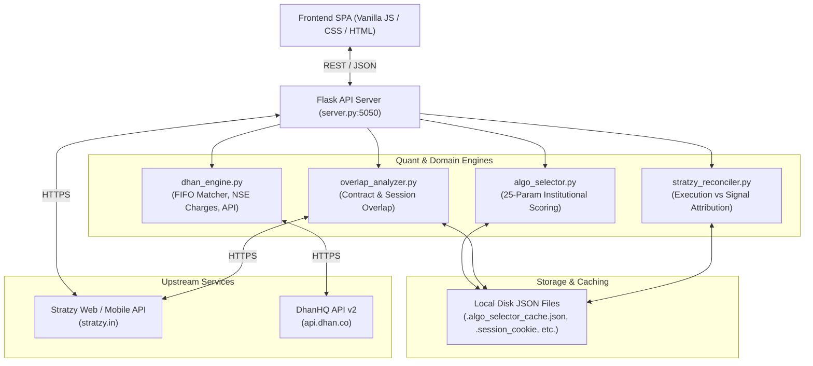

# Architecture — Stratzy Algo Scanner & Strategy Intelligence Dashboard

## 1. System Overview

Stratzy Algo Scanner is an analytical and audit platform designed to evaluate and monitor retail algorithmic trading strategies. It bridges Stratzy's strategy ecosystem with broker execution accounts (specifically Dhan), providing quant-level vetting, trade overlap analysis, and broker tradebook reconciliation.

---

## 2. Frontend Architecture

- **Structure**: Single-Page Application (SPA) without external frameworks.
- **Location**: `frontend/` containing [index.html](file:///home/anisha/Desktop/Sandeep/Stratzy/frontend/index.html), [app.js](file:///home/anisha/Desktop/Sandeep/Stratzy/frontend/app.js), and [styles.css](file:///home/anisha/Desktop/Sandeep/Stratzy/frontend/styles.css).
- **Views**:
  1. **Login Screen**: Session cookie entry and authentication verification.
  2. **Scanner View (`view-scanner`)**: Category selector, multi-parameter scan launcher, real-time progress bar, and scan log.
  3. **Results View (`view-results`)**: Top 5 Institutional Picks card, 25-parameter breakdown modals, strategy comparison table, and Trade Overlap Analyzer (Strategy A/B/C pair-wise and 3-way simultaneous collision matrix).
  4. **Watchlist View (`view-watchlist`)**: Starred strategies persisted in browser `localStorage`.
  5. **Dhan Audit View (`view-dhan`)**: Dhan tradebook CSV/Excel file dropzone, DhanHQ API connection form, FIFO realized P&L dashboard, slippage audit, and fee calculations.
- **State Management**: Managed via a global `state` object in [app.js](file:///home/anisha/Desktop/Sandeep/Stratzy/frontend/app.js) with `localStorage` persistence for the watchlist.

---

## 3. Backend Architecture

- **Entry Point**: [server.py](file:///home/anisha/Desktop/Sandeep/Stratzy/server.py) (Flask application).
- **Serving Mechanism**: Flask serves static assets from `frontend/` on `/` and `/frontend/*` while exposing REST endpoints under `/api/*`.
- **In-Memory Store**: `server.py` maintains an in-memory dictionary `store` tracking session cookies, scan states, cached results, and Dhan connection states.
- **Multi-threading**: Scans run in a background daemon thread spawned via `threading.Thread` to avoid blocking Flask HTTP request cycles.

---

## 4. Quant & Domain Engines

### 4.1. Algo Selector (`algo_selector.py`)
Implements the 25-Parameter Institutional Framework across 5 core pillars:
1. **Return & Risk Quality**: Sharpe (>1.5), Sortino, Calmar (>2.0), Max Drawdown (<=25%), Volatility, Worst Month, Max Consecutive Losses.
2. **Consistency**: Win-Month % (>70%), Win-Quarter % (>75%), Positive 3M/6M/1Y PnL (Hard Stop), Mathematical Expectancy, Risk-Reward Ratio.
3. **Reliability**: Trade count in 3M >= 15 (Hard Stop), Track record >= 180 days, Backtest vs live sanity.
4. **Account Fit**: Minimum Capital <= ₹1,00,000 (Hard Stop), Risk Tag (Low/Medium), Rupee Drawdown on 1 lot, Trade Frequency, Slippage/charges drag.
5. **Portfolio Fit**: Family diversity (Spread/Straddle/Strangle/Buying), Held algo correlation, Live trade overlap <= 2-4 trades (Hard Stop).

### 4.2. Overlap Analyzer (`overlap_analyzer.py`)
- Analyzes potential execution conflicts across 3 chosen strategies or against the user's active portfolio.
- Fetches real historical advice records from `GET https://stratzy.in/api/web/pastAdvices?advisorId={id}`.
- Caches responses in `.stratzy_advices_cache.json` (TTL: 2 hours).
- Calculates exact contract overlap (same date, strike, option type) and trading session concurrency.

### 4.3. Dhan Engine (`dhan_engine.py`)
- **Tradebook Parsing**: Accepts Dhan CSVs, XLSX, and XLS exports. Supports various column header aliases and symbol conventions.
- **FIFO Matching**: Pairs BUY and SELL execution legs in FIFO order to produce closed round-trip trades.
- **Regulatory Fee Calculations**: Accurately computes NSE F&O statutory fees (STT: 0.1% on option sell, brokerage: ₹20/order, exchange turnover fees: 0.0505%, GST: 18%, stamp duty, and SEBI charges).
- **DhanHQ v2 API**: Direct client to fetch fund limits, today's trade book, positions, and 30-day historical executions.

### 4.4. Stratzy Reconciler (`stratzy_reconciler.py`)
- Connects broker executions with published Stratzy signals.
- Uses a ±15-minute execution window matching underlying asset, strike, option type, and transaction side.
- Calculates slippage in index points and INR per trade.

---

## 5. Data Flow & Storage

### Authentication Flow
1. User provides Stratzy session cookie in UI.
2. Server validates cookie against `GET https://stratzy.in/api/mobile/profile`.
3. Valid cookie is written to `.session_cookie` on disk for automatic recovery across server restarts.

### Data Storage Strategy
No heavy external database. Persistence uses local JSON files:
- `.session_cookie`: Active session cookie string.
- `.algo_selector_cache.json`: Scored strategies and top picks (TTL: 1 hour).
- `.stratzy_advices_cache.json`: Scraped advice histories (TTL: 2 hours).
- `stratzy_signals_cache.json`: Historical signal cache.
- `.user_invested_algos.json`: User's active broker portfolio strategies.
- `algo_list.json`: Pre-fetched master catalog of algorithms.
